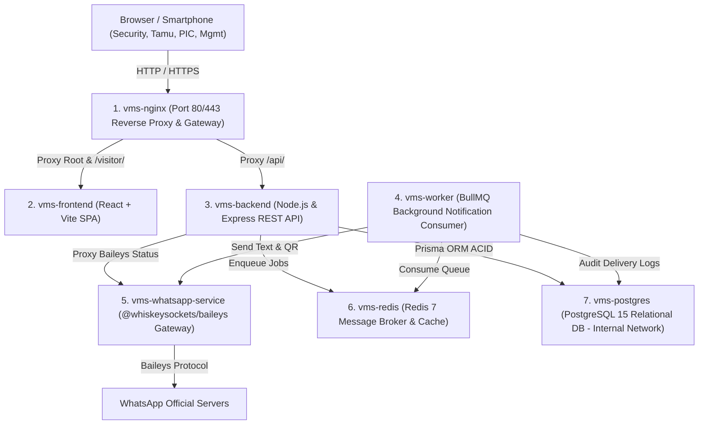

# VISITOR MANAGEMENT SYSTEM (VMS)
## PT CEMINDO GEMILANG TBK – PLANT BATAM

Aplikasi Visitor Management System (VMS) berbasis web modern, tangguh, dan aman untuk mendata dan mengelola seluruh tamu yang berkunjung ke **PT Cemindo Gemilang Tbk – Plant Batam**.

Sistem ini digunakan oleh **Security**, seluruh **Department**, **PIC / Tuan Rumah**, dan **Management** untuk mengelola proses pendaftaran tamu tanpa janji (*Walk-In*), janji temu (*Pre-Registration*), validasi gerbang, *Check-in*, *Check-out*, pemantauan *Emergency Muster Headcount*, *Overstay Alert*, *Visitor Blacklist*, serta laporan rekapitulasi audit kunjungan.

---

## 🏗️ 1. Arsitektur Layanan & Kontainer Docker (Tahap 14)

Aplikasi dibangun dengan arsitektur modular multi-kontainer menggunakan **Docker Compose** yang terdiri dari 7 layanan terisolasi:



### Rincian 7 Kontainer Layanan:
1. **`vms-frontend`**: Single Page Application (React 18, Vite, Tailwind CSS, Lucide Icons, Bilingual English/Indonesian, No AI slops).
2. **`vms-backend`**: REST API Server (Node.js, Express, Prisma ORM, Helmet, Rate Limiters, JWT, bcrypt).
3. **`vms-postgres`**: Database relasional PostgreSQL 15. **Hanya dapat diakses melalui internal Docker Network**, tidak diekspos ke internet publik demi keamanan data industri.
4. **`vms-whatsapp-service`**: Microservice mandiri Baileys `@whiskeysockets/baileys` untuk mengelola koneksi socket WhatsApp, pairing QR, dan pengiriman pesan/tiket QR.
5. **`vms-redis`**: In-memory database Redis 7 untuk penampung antrean notifikasi BullMQ.
6. **`vms-worker`**: Worker mandiri BullMQ untuk memproses pengiriman notifikasi WhatsApp secara asinkron tanpa memperlambat proses Check-In & Check-Out di pos gerbang.
7. **`vms-nginx`**: Master Reverse Proxy Gateway yang menyatukan seluruh layanan, menangani SSL/TLS HTTPS, proteksi *security headers*, serta routing subpath `/visitor` dan subdomain.

---

## 📊 2. Struktur Database Relasional PostgreSQL & Prisma (Tahap 13)

Database menggunakan **UUID v4** sebagai *primary key* pada seluruh tabel dan memisahkan identitas profil tamu dari transaksi kunjungan agar riwayat kunjungan masa lalu tetap tersimpan utuh ketika tamu yang sama datang kembali.

### Daftar Tabel Utama:
* `users`: Akun pengguna internal (Admin, Security, PIC Karyawan, Management).
* `roles`: Master peran sistem (`ADMIN`, `SECURITY`, `HOST_PIC`, `MANAGEMENT`).
* `departments`: 9 Departemen resmi Plant Batam (`HRGA`, `IT`, `Production`, `Maintenance`, `Quality Control`, `Logistic`, `Finance`, `Procurement`, `SHE`).
* `visitors`: Data profil identitas tamu (`fullName`, `identityNumber`, `phoneNumber`, `company`, `email`).
* `visits`: Transaksi kunjungan tamu (`id`, `visitor_id`, `visit_number`, `department_id`, `pic_user_id`, `visit_type`, `purpose`, `scheduled_date`, `expected_arrival_time`, `status`, `created_by`, `check_in_at`, `check_in_by`, `check_out_at`, `check_out_by`, `visitor_badge_number`, `vehicle_plate_number`, `created_at`, `updated_at`).
* `qr_tokens`: Penyimpanan token QR unik sekali pakai (`token`, `token_hash` SHA-256, `type`: `CHECK_IN`/`CHECK_OUT`, `is_used`, `expires_at`).
* `visit_logs`: Audit trail setiap transisi status kunjungan (`SUBMITTED`, `APPROVED`, `CHECKED_IN`, `CHECKED_OUT`, `REJECTED`, `CANCELLED`).
* `notification_logs`: Riwayat pengiriman WhatsApp dengan `idempotency_key`, status, retry count, dan pesan error.
* `management_recipients`: Daftar kontak pejabat Management penerima notifikasi eksekutif kedatangan/kepulangan tamu.
* `whatsapp_sessions`: Penyimpanan status koneksi dan metadata sesi Baileys.
* `system_settings`: Pengaturan dinamis aplikasi (`overstay_hours`, `require_ktp_walkin`, `max_active_visitors_daily`).
* `visitor_blacklists`: Daftar hitam personil bermasalah / pelanggaran K3 Golden Rules.
* `notification_templates`: 10 format pesan notifikasi dinamis dengan placeholder variabel.
* `activity_logs`: Audit trail keamanan seluruh aktivitas perubahan data di sistem.

### Status Kunjungan (`VisitStatus`):
* `PENDING_VALIDATION`: Tamu Walk-In telah mendaftar, menunggu validasi petugas di pos gerbang.
* `APPROVED`: Janji temu telah dibuat dan disetujui, siap divalidasi saat hari H kedatangan.
* `CHECKED_IN`: Tamu telah diverifikasi Security dan aktif berada di dalam kawasan pabrik (*On-Site*).
* `CHECKED_OUT`: Tamu telah keluar pabrik, pass kunjungan dinonaktifkan permanen.
* `REJECTED`: Permohonan kunjungan ditolak oleh Security atau PIC.
* `CANCELLED`: Kunjungan dibatalkan sebelum tamu Check-In.
* `EXPIRED`: Tiket QR kedaluwarsa karena melewati batas tanggal yang ditentukan.

> [!IMPORTANT]
> Seluruh transaksi **Check-In** dan **Check-Out** diproses menggunakan **Database Transaction (`prisma.$transaction`)** untuk menjamin konsistensi ACID dan mencegah data ganda akibat verifikasi bersamaan.

---

## 🔒 3. Keamanan Aplikasi (Tahap 15)

1. **Proteksi Password**: Disimpan menggunakan algoritma `bcryptjs` dengan *salt rounds* 10.
2. **Autentikasi JWT**: Token JWT memiliki masa berlaku (*expiration*) yang dapat dikonfigurasi (`JWT_EXPIRES_IN=24h`).
3. **Otorisasi Role-Based (RBAC)**: Setiap endpoint API dilindungi middleware `authenticateToken` dan `requireRole`.
4. **Isolasi Database**: Port PostgreSQL `5432` **tidak diekspos ke internet publik**, melainkan hanya dapat diakses melalui jaringan internal Docker `vms_internal`.
5. **Proteksi Header & Injeksi**:
   * Dilengkapi `helmet` untuk menonaktifkan header berbahaya dan mencegah serangan clickjacking.
   * Pencegahan SQL Injection otomatis melalui *parameterized queries* Prisma ORM.
6. **Perlindungan Privasi Tamu (PII Protection)**: NIK / nomor identitas KTP otomatis dimasking (`2171******01`) untuk pengguna non-privilese (hanya Admin & Security yang dapat melihat nomor lengkap).
7. **Rate Limiting**:
   * Form Walk-In publik: maksimal 30 submit per 15 menit per IP.
   * Scanner QR: maksimal 60 scan per menit per IP.
   * Autentikasi Login: maksimal 20 percobaan per 15 menit per IP.
   * Global API: maksimal 1000 request per 15 menit per IP.
8. **Keamanan Sesi WhatsApp**: Kredensial Baileys disimpan terisolasi dalam Docker Volume permanen `vms_wa_auth:/app/baileys_auth` dan tidak bocor ke publik.
9. **Single-Use QR Token**: Token QR menggunakan kode acak kriptografis dengan pencocokan hash SHA-256. Begitu Check-Out diproses, token langsung berstatus `isUsed: true` dan ditolak jika dipindai kembali.

---

## 🚀 4. Panduan Instalasi & Menjalankan Aplikasi

Aplikasi dirancang agar dapat dijalankan di **Windows (Docker Desktop)** saat pengembangan, dan dipindahkan ke **Ubuntu Server** tanpa perlu mengubah kode sumber aplikasi.

### A. Prasyarat Sistem
* **Windows**: Docker Desktop dengan WSL2 backend aktif.
* **Ubuntu Server**: Docker Engine versi 24+ dan Docker Compose Plugin (`docker compose`).
* Port yang diperlukan:
  * Port `80` (HTTP Gateway Nginx)
  * Port `443` (HTTPS Gateway Nginx)

---

### B. Langkah Instalasi di Windows (Docker Desktop)

1. **Buka Terminal / PowerShell di folder proyek:**
   ```powershell
   cd d:\dev\vms
   ```

2. **Siapkan file Environment Variables:**
   Salin file `.env.example` menjadi `.env`:
   ```powershell
   Copy-Item .env.example .env
   ```
   *(Secara default, file `.env` lokal sudah siap pakai untuk pengujian)*.

3. **Jalankan seluruh layanan menggunakan Docker Compose:**
   ```powershell
   docker compose up -d --build
   ```

4. **Periksa status kontainer:**
   ```powershell
   docker compose ps
   ```
   Pastikan ketujuh kontainer berstatus `healthy` atau `Up`:
   * `vms-postgres`
   * `vms-redis`
   * `vms-whatsapp-service`
   * `vms-worker`
   * `vms-backend`
   * `vms-frontend`
   * `vms-nginx`

5. **Akses Aplikasi melalui Browser:**
   * **Portal VMS / Login:** [http://localhost](http://localhost) (atau [http://localhost:5173](http://localhost:5173))
   * **Pendaftaran Mandiri Tamu (Walk-In):** [http://localhost/visitor/register](http://localhost/visitor/register)
   * **Health Check API Backend:** [http://localhost/api/health](http://localhost/api/health)
   * **Health Check Nginx:** [http://localhost/nginx-health](http://localhost/nginx-health)

---

### C. Langkah Deployment di Ubuntu Server (Produksi)

1. **Clone repository atau salin source code ke server:**
   ```bash
   sudo mkdir -p /opt/vms
   cd /opt/vms
   # Salin seluruh file proyek ke /opt/vms
   ```

2. **Buat file `.env` produksi:**
   ```bash
   cp .env.example .env
   nano .env
   ```
   *Ubah nilai `POSTGRES_PASSWORD` dan `JWT_SECRET` dengan string acak yang kuat.*

3. **Jalankan kontainer di latar belakang:**
   ```bash
   sudo docker compose up -d --build
   ```

4. **Konfigurasi SSL / HTTPS (Let's Encrypt / Certbot):**
   * Pasang sertifikat SSL untuk domain Anda (misal `vms.cg-plantbatam.com`):
     ```bash
     sudo apt install -y certbot
     sudo certbot certonly --standalone -d vms.cg-plantbatam.com
     ```
   * Salin template konfigurasi SSL yang sudah disiapkan:
     ```bash
     sudo cp nginx/conf.d/ssl.conf.template nginx/conf.d/ssl.conf
     ```
   * Muat ulang Nginx:
     ```bash
     sudo docker compose exec vms-nginx nginx -s reload
     ```

---

## 🌐 5. Konfigurasi Deployment: Subpath `/visitor` dan Subdomain

Nginx telah dikonfigurasi siap pakai untuk mendukung 2 metode akses:

### Opsi 1: Menggunakan Subdomain Khusus (Rekomendasi)
* **URL Aplikasi:** `https://vms.cg-plantbatam.com/`
* **URL Form Tamu:** `https://vms.cg-plantbatam.com/visitor/register`

### Opsi 2: Menggunakan Subpath pada Domain Utama
* **URL Aplikasi:** `https://cg-plantbatam.com/visitor/`
* Seluruh permintaan ke path `^~ /visitor/` otomatis diteruskan oleh Nginx ke frontend Single Page Application secara transparan tanpa mengubah struktur routing React.

---

## 🔑 6. Akun Pengguna Bawaan (Pre-Seeded Accounts)

Gunakan akun berikut untuk pengujian sesuai hak akses (*tersedia fitur 1-Klik Isi Cepat di halaman Login*):

| Role | Email | Password | Penanggung Jawab / Posisi |
| :--- | :--- | :--- | :--- |
| **Administrator** | `admin@cemindo.com` | `admin123` | Administrator Sistem (Akses Penuh) |
| **Danru Security** | `security.agus@cemindo.com` | `security123` | Agus Pratama (Komandan Regu Security) |
| **Security Gate 1** | `security.bambang@cemindo.com` | `security123` | Bambang Sugiarto (Petugas Pos Gerbang 1) |
| **Security Gate 2** | `security.rian@cemindo.com` | `security123` | Rian Hidayat (Petugas Pos Gerbang 2) |
| **PIC Production** | `pic.production@cemindo.com` | `pic123` | Budi Santoso (Host Departemen Produksi) |
| **PIC IT** | `pic.it@cemindo.com` | `pic123` | Ahmad Fauzi (Host Departemen IT) |
| **PIC HRGA** | `pic.hrga@cemindo.com` | `pic123` | Siti Rahmawati (Host Departemen HRGA) |
| **PIC SHE** | `pic.she@cemindo.com` | `pic123` | Hendra Gunawan (Host Departemen SHE/Safety) |
| **Management** | `management.wahyu@cemindo.com` | `management123` | Ir. Wahyu Hidayat (Plant General Manager) |

---

## 💾 7. Manajemen Backup & Restore Data

### Backup Database PostgreSQL:
```bash
docker exec -t vms-postgres pg_dump -U vms_user -d vms_batam > vms_backup_$(date +%Y%m%d_%H%M%S).sql
```

### Restore Database PostgreSQL:
```bash
cat vms_backup_YYYYMMDD_HHMMSS.sql | docker exec -i vms-postgres psql -U vms_user -d vms_batam
```

### Backup Sesi WhatsApp (Docker Volume):
Sesi WhatsApp tersimpan permanen di volume `vms_wa_auth`. Sesi ini tidak akan terhapus meskipun kontainer dimatikan, dihapus, atau dibuat ulang (*recreate*).

```bash
docker run --rm -v vms_wa_auth:/data -v $(pwd):/backup alpine tar czf /backup/wa_session_backup.tar.gz -C /data .
```

---

## 📋 8. Checklist Verifikasi Standar K3 & Operasional

- [x] **Walk-In Self-Registration**: Tamu mendaftar tanpa login via QR pos masuk.
- [x] **Pre-Registration**: PIC mendaftarkan janji temu dan mengirim tiket QR ke WhatsApp tamu.
- [x] **Security Camera QR Scanner**: Mendukung pemilihan kamera depan atau belakang HP.
- [x] **Single-Use QR Enforcement**: QR Check-In tidak dapat dipakai untuk Check-Out; QR Check-Out hangus permanen setelah Check-Out.
- [x] **Direct Baileys WhatsApp Gateway**: Tanpa gateway berbayar pihak ketiga (Fonnte/Twilio).
- [x] **10 Template Notifikasi Otomatis**: Pesan tersusun rapi dengan informasi dinamis.
- [x] **Management Recipient Alerts**: Jajaran pimpinan menerima ringkasan otomatis saat tamu tiba & pulang.
- [x] **Dashboard Multi-Role**: Desain industrial bebas AI slops dengan grafik 14 hari dan statistik per departemen.
- [x] **Laporan & Export Excel**: 14 kolom lengkap dengan filter multi-kriteria.
- [x] **Emergency Visitor Roll-Call**: Headcount real-time evakuasi darurat muster point K3.
- [x] **Overstay Alert**: Deteksi tamu yang berada di pabrik melebihi batas waktu (default 8 jam).
- [x] **Visitor Blacklist**: Pemblokiran otomatis terhadap tamu bermasalah di pintu masuk.
- [x] **Modular 7-Service Docker Architecture**: Nginx, Frontend, Backend, WhatsApp Service, Worker, Redis, Postgres.
- [x] **Enterprise Security**: Helmet, Rate Limiter, PII Masking, Internal Postgres Network, Transaction ACID Check-in/Check-out.
