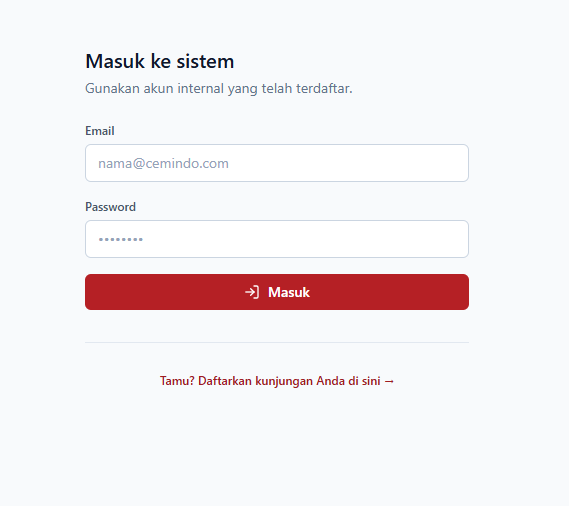
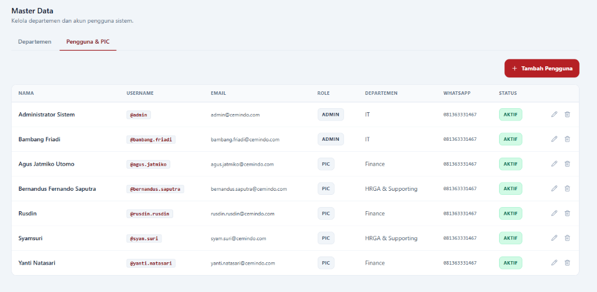
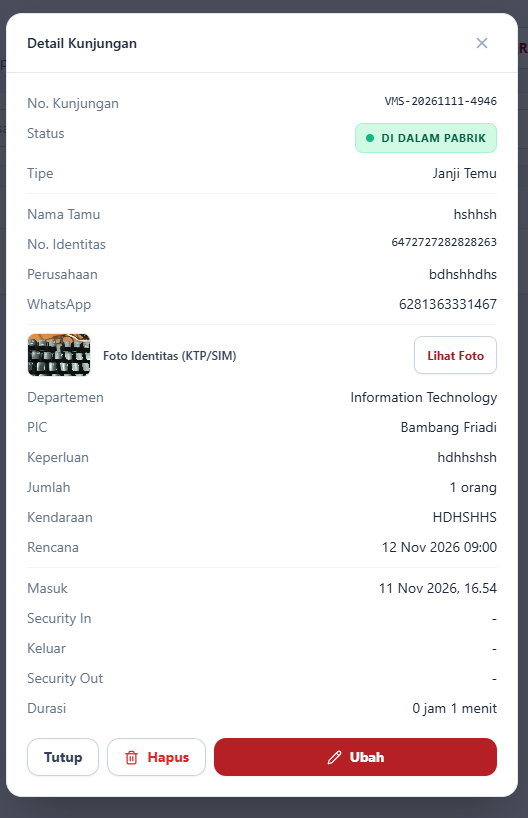
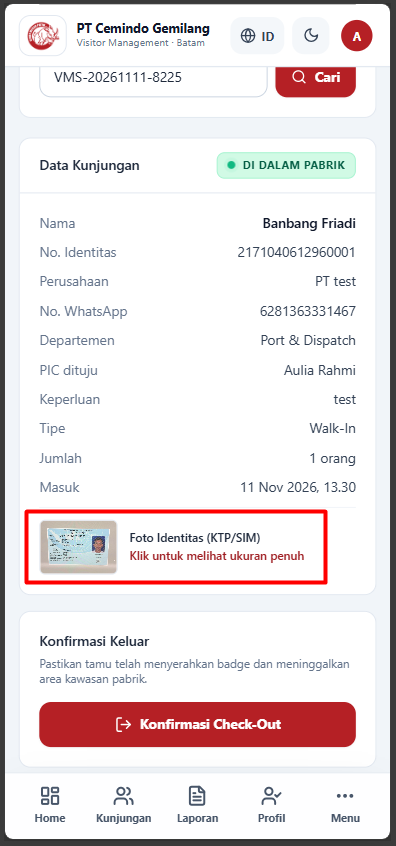
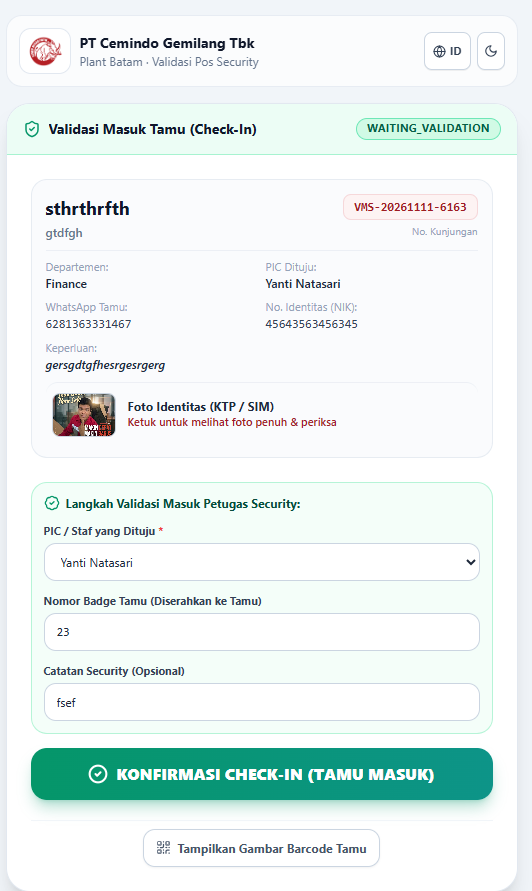
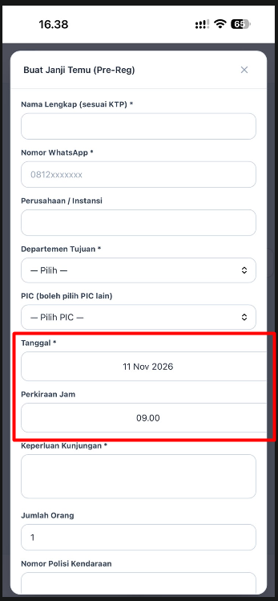
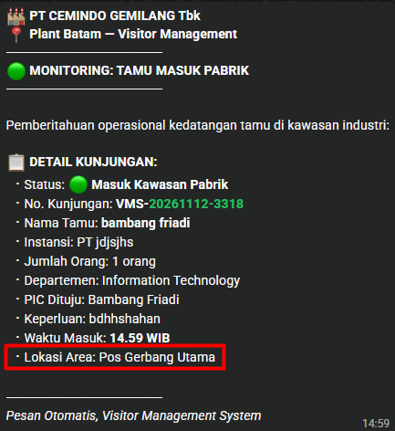
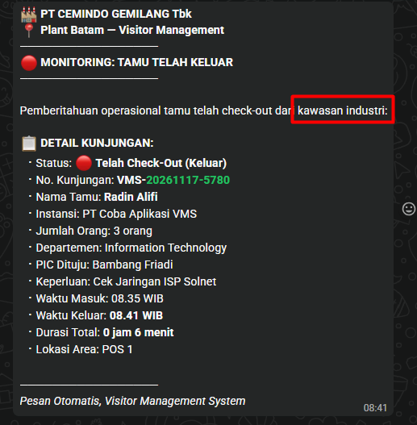

# VISITOR MANAGEMENT SYSTEM (VMS) — PLANT BATAM
## PT CEMINDO GEMILANG Tbk
### Dokumen Panduan Eksekutif & Cara Kerja Sistem (End-to-End) untuk Bahan Presentasi Manajemen

---

**Penyusun:** Tim Pengembang Sistem VMS Plant Batam  
**Target Audiens:** Direksi, General Manager, Plant Manager, Safety/HSE Manager, Security Supervisor, IT & Department Head  
**Lokasi:** Kawasan Pabrik PT Cemindo Gemilang Tbk — Plant Batam  
**Status Sistem:** *Production Ready (Dockerized, PWA Enabled, Real-Time WhatsApp Integrated)*  

---

## 1. Latar Belakang & Urgensi Bisnis

Sebagai kawasan industri semen dengan aktivitas operasional dan standar **Keselamatan dan Kesehatan Kerja (K3)** serta standar pengamanan kawasan industri yang ketat, kepastian mengenai siapa yang berada di dalam kawasan pabrik pada setiap detiknya adalah prioritas keselamatan dan keamanan tertinggi.

### Masalah Sebelum Penerapan VMS:
- **Pencatatan Manual**: Buku tamu fisik di Pos Security mudah robek, kotor oleh debu pabrik, dan tidak dapat dicari dengan cepat.
- **Antrean Jam Sibuk**: Tamu vendor/kontraktor menumpuk di gerbang karena proses tulis tangan dan verifikasi identitas yang lambat.
- **Keterlambatan Informasi**: Karyawan (PIC) sering tidak tahu bahwa tamu mereka sudah tiba di Pos 1.
- **Blind-Spot Manajemen**: Manajemen tidak memiliki visibilitas real-time mengenai berapa banyak orang luar yang sedang berada di area pabrik.
- **Kendala Evakuasi Darurat**: Saat terjadi simulasi atau insiden darurat, sulit mendata siapa saja tamu yang terjebak di area pabrik.

---

## 2. Arsitektur & Keunggulan Teknologi

```
+---------------------------------------------------------------------------------+
|                                 PENGGUNA                                        |
|   [Tamu Walk-In]     [Petugas POS 1]       [Karyawan PIC]      [Management]     |
+---------------------------------------------------------------------------------+
                                      | (HTTPS / PWA)
                                      v
+---------------------------------------------------------------------------------+
|                       FRONTEND: REACT + TAILWIND (PWA)                          |
|    - Responsif Mobile & Desktop           - Dukungan Dark Mode & Multi-Bahasa   |
|    - Kamera Scanner QR & Foto KTP         - Tesseract OCR (Ekstraksi NIK)       |
+---------------------------------------------------------------------------------+
                                      | (REST API)
                                      v
+---------------------------------------------------------------------------------+
|                     BACKEND: NODE.JS + PRISMA ORM                               |
|    - Autentikasi JWT Multi-Login          - Auto-Lookup Tamu Berulang           |
|    - Audit Trail & Privasi Data           - Life-cycle Data Kunjungan           |
+---------------------------------------------------------------------------------+
                 |                                                |
                 v                                                v
+---------------------------------+             +---------------------------------+
|      DATABASE POSTGRESQL 15     |             |    BAILEYS WHATSAPP GATEWAY     |
|  - Penyimpanan Data Terenkripsi |             |  - Notifikasi Tamu Masuk        |
|  - Relasi Kunjungan & Identitas |             |  - Notifikasi Tamu Keluar       |
|  - Pembersihan Otomatis Data    |             |  - Tiket QR Tamu & OTP Password |
+---------------------------------+             +---------------------------------+
```

---

## 3. Pembagian Peran & Hak Akses (Role-Based Access Control)

| Peran | Tanggung Jawab Utama | Akses Fitur Kunci |
|---|---|---|
| **Administrator (IT / HSE)** | Tata kelola sistem, master data, dan audit kepatuhan | Manajemen User, Pengaturan Departemen, WhatsApp Gateway, Audit Data, Hapus Kunjungan |
| **Security (POS 1)** | Pemeriksaan fisik, validasi gerbang masuk/keluar, dan penyerahan badge | Scanner Barcode Cepat, Check-In, Check-Out, Monitoring Tamu Onsite |
| **PIC (Karyawan)** | Mengundang rekanan dan menyetujui izin masuk tamu ke departemennya | Buat Janji Temu (Pre-Registration), Riwayat Tamu Departemen, Approval |
| **Management** | Pengawasan strategis dan visibilitas operasional pabrik | Executive Dashboard Real-Time, Notifikasi Otomatis Masuk/Keluar via WhatsApp |
| **Tamu (Visitor)** | Pengisian identitas mandiri tanpa perlu login akun | Pendaftaran Walk-in via QR Code gerbang, Penerimaan QR Code Pass via WhatsApp |

---

## 4. Alur Kerja Sistem dari Awal hingga Akhir (End-to-End Workflow)

```
[1. Tamu Walk-in / Undangan PIC]
              |
              v
[2. Input Data Utama & Foto KTP Penanggung Jawab]
              |
              v
[3. Input Jumlah Tamu & Seluruh Nama Rekan Rombongan (Wajib)]
              |
              v
[4. Terbitkan Tiket QR Code Masuk]
              |
              v
[5. Tiba di POS 1 Security]
              |
              v
[6. Scan QR & Security Verifikasi Seluruh Rombongan]
              |
              v
[7. CHECK-IN MASUK PABRIK (Dashboard Bertambah Sesuai Jumlah Riil)]
              |
      +-------+-------+
      |               |
      v               v
[WA ke PIC]     [WA ke Management]
                (Disertai Daftar Lengkap Nama Rombongan)
```

---

## 5. Galeri Tangkapan Layar & Panduan Presentasi Slide

Seluruh gambar tersimpan di folder `screenshots/` dan siap diproyeksikan ke slide presentasi:

### Slide 1: Pintu Masuk Sistem & Autentikasi

- **Fokus Penjelasan:** Akses fleksibel dengan Multi-Login (Email Cemindo, Username, No. HP), pemulihan kata sandi mandiri via OTP WhatsApp, dan pemilihan bahasa (ID/EN).

---

### Slide 2: Dashboard Eksekutif & Monitoring Real-Time

- **Fokus Penjelasan:** Jajaran Direksi dan Plant Manager dapat melihat metrik kunjungan harian, tamu yang sedang aktif onsite, dan grafik tren departemen secara real-time.

---

### Slide 3: Pendaftaran Mandiri Tamu Walk-in (OCR & Auto-Lookup)

- **Fokus Penjelasan:** Tamu cukup scan QR di stand POS 1. Fitur pintar Auto-Lookup langsung mengenali tamu berulang, dan OCR membaca NIK secara otomatis dari foto KTP.

---

### Slide 4: Pra-Registrasi & Undangan Resmi oleh Karyawan (PIC)

- **Fokus Penjelasan:** Karyawan dapat menjadwalkan kedatangan vendor/auditor sebelum hari H. Tamu otomatis menerima pesan WhatsApp undangan resmi berisikan QR Code masuk.

---

### Slide 5: Operasional Pos Security POS 1 (Scan Barcode & Validasi)

- **Fokus Penjelasan:** Petugas security hanya butuh 3 detik untuk memindai tiket tamu, mencocokkan foto KTP di layar, memberikan badge fisik, dan memvalidasi akses masuk/keluar.

---

### Slide 6: Data Kunjungan, Audit Trail & Ekspor Laporan

- **Fokus Penjelasan:** Rekapitulasi data lengkap untuk kebutuhan audit ISO/K3/pengamanan dengan ekspor Microsoft Excel resmi serta proteksi privasi otomatis (UU PDP).

---

### Slide 7: Notifikasi Real-Time Tamu Masuk Pabrik

- **Fokus Penjelasan:** Manajemen dan PIC menerima notifikasi WhatsApp secara instan saat tamu tervalidasi masuk di POS 1.

---

### Slide 8: Notifikasi Real-Time Tamu Keluar Pabrik

- **Fokus Penjelasan:** Begitu tamu check-out di POS 1, manajemen menerima notifikasi kepulangan lengkap dengan rincian total durasi waktu tamu berada di kawasan pabrik.

---

## 6. Dampak Bisnis & Nilai Investasi (Impact & ROI)

1. **Efisiensi Waktu Hingga 85%**: Registrasi manual di pos security yang biasanya memakan waktu 5 menit kini selesai dalam waktu kurang dari 30 detik.
2. **Kepatuhan K3 & Tanggap Darurat**: Menyediakan data presisi siapa saja orang luar yang berada di area pabrik setiap saat untuk evakuasi darurat.
3. **Penghematan Biaya Operasional**: Menggunakan arsitektur WhatsApp Gateway mandiri tanpa biaya langganan bulanan vendor SMS/API pihak ketiga.
4. **Keamanan & Kepatuhan Regulasi Privasi**: Sistem secara otomatis membersihkan foto identitas KTP jika data kunjungan telah dihapus dari sistem.
5. **Modernisasi Citra Industri**: Meningkatkan reputasi PT Cemindo Gemilang Tbk sebagai pabrik semen modern berstandar industri 4.0.

---
*PT Cemindo Gemilang Tbk — Plant Batam | Visitor Management System (VMS)*
